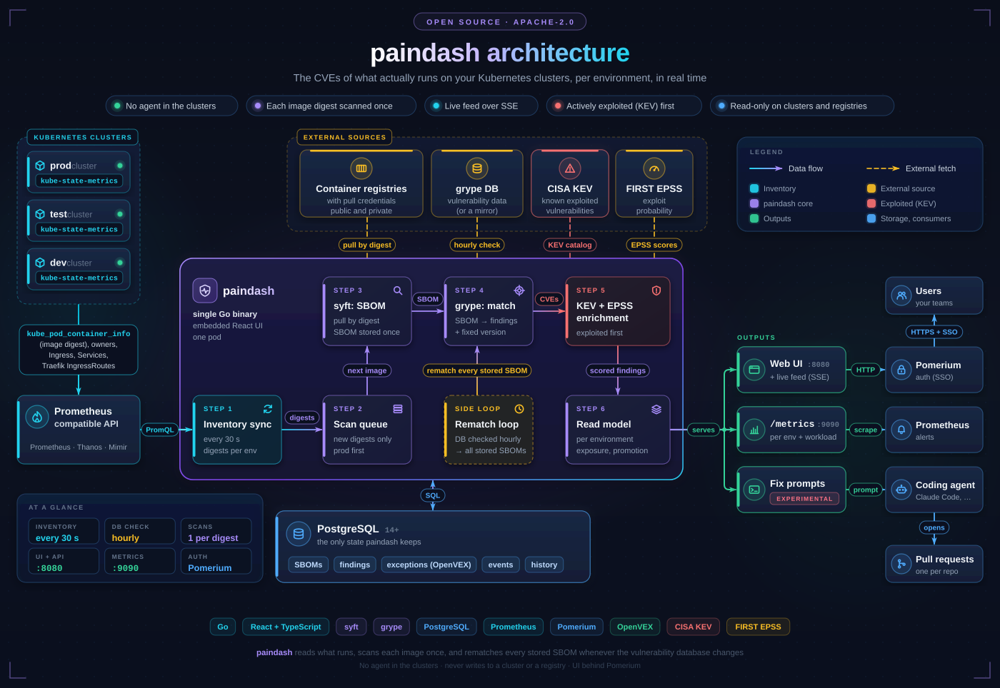
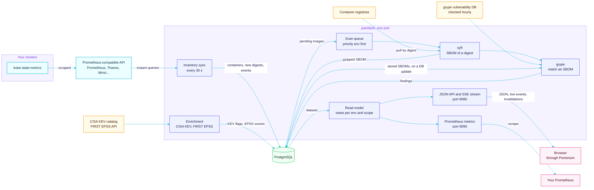
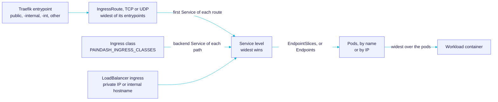
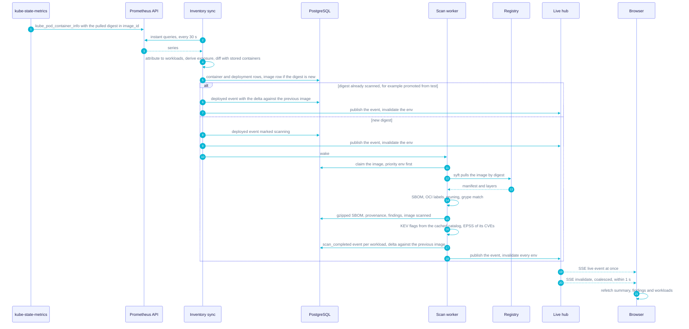
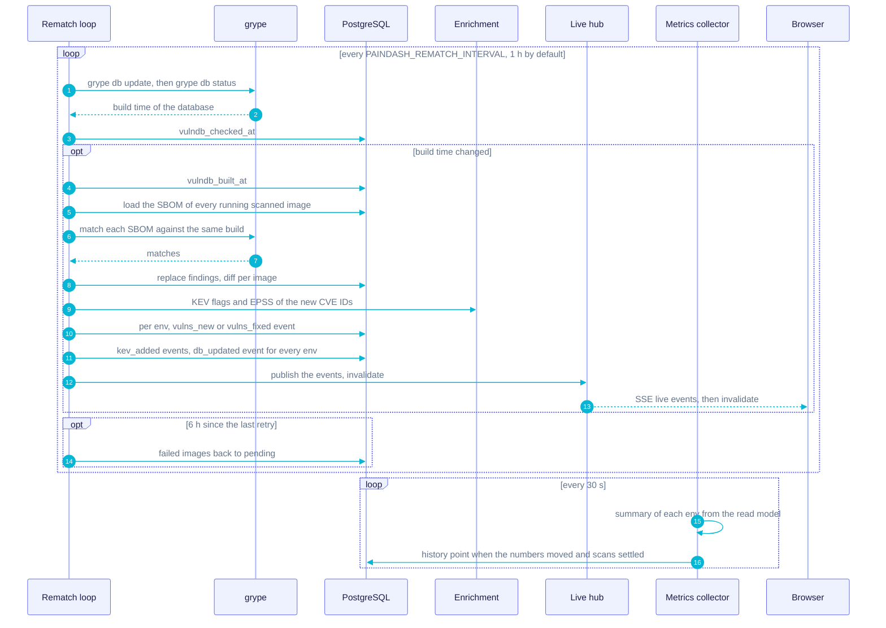
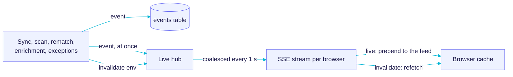

# How paindash works

paindash is one Go binary (the React UI is embedded in it) running as a single pod, with
PostgreSQL as its only state. Background loops turn what runs into an inventory, scan each new image
digest once, rematch stored SBOMs when the vulnerability database changes, and push what changed to
the browsers. This page describes each part. For what the UI shows, see the [user guide](guide.md);
to install, see [deploy/README.md](../deploy/README.md).

## Overview

| Package | Role |
|---|---|
| `cmd/paindash` | Entry point: the server, `paindash snapshot` (print the inventory) and `paindash scan <ref>` (scan one image) |
| `internal/inventory` | Reads the kube-state-metrics series, attributes containers to workloads, derives exposure |
| `internal/pipeline` | Background loops: inventory sync, scan workers, rematch, retries, enrichment, initial scan progress; turns changes into events |
| `internal/scan` | Runs syft and grype, parses their output, prunes misidentified binaries, reads provenance labels, prepares registry credentials |
| `internal/enrich` | CISA KEV and FIRST EPSS clients |
| `internal/store` | PostgreSQL: migrations, writes, the read dataset, events, history, exceptions |
| `internal/view` | Read models: scope, findings, summary, workloads, promotion hints, image origin |
| `internal/api` | HTTP API, SSE stream, Prometheus metrics, history recording, exceptions and OpenVEX |
| `internal/live` | Fan-out of events and invalidations to connected browsers |
| `internal/auth` | Pomerium assertion verification |
| `internal/demo` | Simulated clusters, scanner and history for the demo |
| `web` | React + TypeScript UI, embedded in the binary |

### Cadences

| What | Default | Setting |
|---|---|---|
| Inventory sync | 30 s | `PAINDASH_SYNC_INTERVAL` |
| Vulnerability DB check, rematch on change | 1 h | `PAINDASH_REMATCH_INTERVAL` |
| Retry of a failed scan attempt | 2 min × attempts, 3 attempts | |
| Retry of failed images, fresh budget | every 6 h, and at startup | |
| CISA KEV catalog | 1 h | `PAINDASH_KEV_INTERVAL` |
| EPSS scores of every CVE | 24 h | |
| Initial scan progress events | 1 min | `PAINDASH_PROGRESS_INTERVAL` |
| Metrics snapshot and history check | 30 s | |
| History point | on change, at least 5 min apart; at least daily | |
| Live invalidation flush | 1 s | |
| SSE heartbeat | 15 s | |
| Cluster missing from a snapshot | kept 15 min | |
| Pruning of retired images and old events | hourly check, `720h` retention | `PAINDASH_RETENTION` |
| Scanner timeouts | SBOM 15 min, match 10 min, DB update 10 min | |

## Inventory and workload attribution

Every sync runs instant queries (`/api/v1/query`) against the Prometheus-compatible API:

| Series | Used for |
|---|---|
| `kube_pod_container_info`, `kube_pod_init_container_info` | containers, image as deployed (`image_spec`), digest pulled (`image_id`) |
| `kube_pod_owner`, `kube_replicaset_owner`, `kube_job_owner` | workload attribution |
| `kube_service_status_load_balancer_ingress`, `kube_ingress_info`, `kube_ingress_path`, `kube_traefik_ingressroute{,tcp,udp}_{entrypoint,service}`, `kube_endpointslice_endpoints`, `kube_endpoint_address`, `kube_pod_info` | exposure |

- **Environments and clusters** come from two series labels (`PAINDASH_ENV_LABEL`, default `env`;
  `PAINDASH_CLUSTER_LABEL`, default `cluster`). Queries carry `{env=~"prod|test|dev"}` built from
  `PAINDASH_ENVS`, unless `PAINDASH_DEFAULT_ENV` is set: then nothing is filtered and series without
  the env label get the default. Series without a cluster label get `PAINDASH_DEFAULT_CLUSTER`
  (`default`).
- **Thanos.** Queries send `dedup=true` and `partial_response=false`: if a store is down, the sync
  fails and is retried, instead of concluding that a cluster stopped running. Prometheus ignores
  both parameters.
- **Digest.** From `image_id` (`repo@sha256:…`, with any `docker-pullable://` prefix removed). A
  bare `sha256:…` is an image config ID on some runtimes, not a manifest digest: the digest is then
  taken from `image_spec` if it has one. Containers without a digest (not started yet) are skipped.
- **Workload.** Pod → ReplicaSet → Deployment and Pod → Job → CronJob, from the owner series,
  preferring the controller owner. Other owners (StatefulSet, DaemonSet...) are used as is; a pod
  without owner is its own workload (kind `Pod`).
- **Missing owner series.** A ReplicaSet or Job deleted before its pods, or not scraped yet, has no
  owner series. Its controller-made name then gives the workload: `<deployment>-<pod-template-hash>`
  (6 to 10 characters of the Kubernetes "safe" alphabet) is attributed to that Deployment, and
  `<cronjob>-<8+ digits>` to that CronJob. A ReplicaSet or Job that does have a series, without
  owner, stays one.
- **Deduplication.** Replicas running the same digest are one container
  (cluster, namespace, kind, name, container, digest), with the pods behind it kept for exposure.

The sync then diffs the snapshot with the stored `containers`:

- **Added** rows create the image (status `pending`) if the digest is new, the container and a
  `deployments` row (append-only history of what each workload container ran).
- **Removed** rows are deleted. Images no longer run by any container get `retired_at`; they come
  back to life if the digest runs again.
- **Exposure changes** update the rows in place.
- **A cluster absent from the snapshot** keeps its rows for 15 minutes (scrape gap, store restart)
  before they count as removed.
- **The very first sync** is quiet: one "Initial inventory: N workloads, M images to scan" event per
  environment instead of one per deployment, images flagged `quiet` (no per-image scan events), a
  progress event per environment every minute, and "Initial scan complete" at the end.
- Afterwards, one **`deployed`** event per changed workload, comparing the new image with the
  previous one of the same workload container when both are scanned, and one **`removed`** event
  per workload gone (Jobs and CronJobs excepted: they come and go with each run, and a run of an
  image they already ran is not news).
- New digests **wake the scan workers**; the affected environments are invalidated.

Each sync also announces exceptions that just expired, and an hourly prune deletes images retired
for longer than `PAINDASH_RETENTION` (with their SBOM and findings), events older than it, and
repeated deployment rows.

## Exposure derivation

| Source | Rule |
|---|---|
| Traefik entrypoint | `internet` if in `PAINDASH_PUBLIC_ENTRYPOINTS` (default `web`, `websecure`); `internal` if it ends in `-internal` or `-int`; anything else is `internet`, logged once as "unclassified Traefik entrypoint" |
| IngressRoute | the widest level of its entrypoints, given to the Service of each route (`service_namespace` when set, else the route's namespace); routes to a `TraefikService` are skipped |
| Ingress | its class mapped by `PAINDASH_INGRESS_CLASSES` (`class=internet` or `class=internal`); an unlisted class, or none, is `internal` if its name contains `internal` or `private`, `internet` otherwise; given to the Service of each path (resource backends skipped) |
| LoadBalancer Service | `internal` if its ingress IP is private (RFC 1918, `fc00::/7`) or its hostname contains `internal`; `internet` otherwise |
| Service to pods | `kube_endpointslice_endpoints`: the pods named by `targetref_name`, in slices named after the Service (`<service>-` cut to 58 characters, then 5 random characters, as the apiserver generates them); and `kube_endpoint_address` IPs, mapped back to pods with `kube_pod_info`, where host-network pods share the node IP and are skipped. Both are read; the widest level wins |
| Workload container | the widest level over its pods (replicas can differ during a rollout); `none` without any |

HTTP, TCP and UDP routes are keyed by kind, so routes with the same name do not collide.
`exposure_available` is recorded at each sync: true when at least one entrypoint, Ingress path or
LoadBalancer series exists, and every cluster that has some also has EndpointSlice or Endpoints
series (a cluster without them is logged once). When false, the UI hides exposure instead of
showing every workload as `none`.

## Scanning

### Queue

The `images` table is the queue. A worker claims the next image with
`UPDATE … FOR UPDATE SKIP LOCKED`: status `pending`, retry time reached, still running somewhere,
images running in the first environment of `PAINDASH_ENVS` first, then oldest first.
`PAINDASH_SCAN_CONCURRENCY` workers (default 2) run in parallel; idle workers wake on new digests
or every 30 s. At startup, images left `scanning` by a previous pod go back to `pending`, and
scanning waits until a vulnerability database is available (retried every 30 s).

### SBOM

`syft scan registry:<repo@sha256:…> -o syft-json` pulls the image straight from the registry, no
container daemon involved.

- **Platform retry.** syft picks the variant of its own platform. When the image has none
  (`no child with platform`), the scan is retried once with the other one (`linux/arm64` from an
  amd64 pod, `linux/amd64` from an arm64 one), for clusters mixing node architectures.
- **Registry credentials.** `PAINDASH_PULL_SECRET` (a `.dockerconfigjson` path) and
  `PAINDASH_ECR_REGISTRIES` (handled by the ECR credential helper with the pod's IAM role) are
  merged into a Docker config that syft uses. Credentials are never logged.
- **Storage.** The syft JSON is stored **gzipped** in `images.sbom`, so the image never needs to be
  pulled again.
- **Provenance.** The OCI labels `org.opencontainers.image.source` and
  `org.opencontainers.image.revision` recorded in the SBOM are stored on the image (bounded to 300
  characters: they come from the image). They decide where fix prompts send a fix. Images scanned
  before this existed are backfilled from their stored SBOM at startup.

### Matching

`grype sbom:<file> -o json`, with `GRYPE_DB_AUTO_UPDATE=false`: the database only changes through
`grype db update`, so every image of a rematch run is matched against the same build.

- **Pruning.** Before matching, packages that syft's binary classifier guessed for a file already
  identified from build information (Go module binary, Rust cargo-auditable) are dropped. The
  classifier pattern-matches version strings and can pick the wrong one (for example, the Go
  toolchain version of a traefik v3 binary, read as traefik 1.x). Pruning happens at match time,
  so stored SBOMs benefit at the next rematch.
- **IDs.** A match reported under an advisory such as `GHSA-…` uses its CVE alias when there is one,
  so that KEV and EPSS (keyed by CVE) apply and the same flaw is not counted twice.
- **Fix.** Fixed versions are kept only when grype's fix state is `fixed`.
- **Source.** Each finding records how its package was identified, from the syft cataloger: OS
  package database, build info, language manifest, or heuristic (binary classifier).
- **Saving.** In one transaction: vulnerabilities upserted (EPSS and KEV kept), the image's findings
  replaced (each one keeps its `first_seen`), the image marked `scanned`, and the change computed
  (vulnerabilities added and removed), from which the events are built.

### Rematch

Every `PAINDASH_REMATCH_INTERVAL` (1 h), `grype db update` then `grype db status` give the build
time of the database. When it changed (and it is not the very first database seen), every running,
scanned image with a stored SBOM is matched again, with the scan concurrency. Retired images are
not rematched; if their digest runs again, their stored findings apply at once and the next rematch
refreshes them.

Once at startup, when the matching rules of this release (`RulesVersion` in `internal/scan`)
differ from the ones that produced the stored findings, every SBOM is rematched with the new rules
("Matching rules updated").

### Failures and retries

A failed attempt records the scanner's error and schedules a retry after `attempts × 2 min`. After 3
attempts the image is `failed`, with a `scan_failed` event (not during the initial scan). At
startup and every 6 hours, failed images that still run go back to `pending` with a fresh budget,
so that fixed causes (credentials, network policies) heal on their own. Errors keep the end of the
scanner's stderr, with URL query strings removed: registry blob redirects are pre-signed URLs.

### Vulnerability database and scanners

- `PAINDASH_GRYPE_DB_URL` points grype at a mirror of its database listing (it sets
  `GRYPE_DB_UPDATE_URL`), for air-gapped clusters. The database (about 3 GB) lives in
  `GRYPE_DB_CACHE_DIR`, on a persistent volume in the provided manifests.
- syft and grype are **built from source** in the Dockerfile, pinned to releases at least two weeks
  old, compiled with the project's Go toolchain and with dependency overrides (see
  [tools/README.md](../tools/README.md)). They are run as CLIs rather than imported as libraries:
  their JSON outputs are stable, their Go APIs move fast.

## Sequence: a new image is deployed

The previous image of the workload stops being counted at the sync that no longer sees it. The
"Deployed" event can then show `−N` vulnerabilities, and an open finding drawer "no longer
detected".

## Sequence: the vulnerability database updates

Per environment, the `vulns_new` event says how many vulnerabilities were added on how many
workloads, with their severities ("New CVEs published: 3 vulnerabilities on 5 workloads (1
critical, 2 high)"); `vulns_fixed` says how many no longer apply. The UI refetches `/api/meta` on
`db_updated`, which updates the CVE DB badge.

## Enrichment: CISA KEV and FIRST EPSS

- **KEV.** The catalog is downloaded every `PAINDASH_KEV_INTERVAL` (1 h) and kept in memory.
  Vulnerabilities in it are flagged with the date they were added. The first load is silent; after
  that, each vulnerability newly flagged and running somewhere produces a `kev_added` event in every
  environment running it.
- **EPSS.** Scores and percentiles of every stored CVE are refreshed every 24 hours, by batches of
  100 CVEs.
- **At scan time.** The CVEs of a newly scanned image, and the new CVEs of a rematch, get their KEV
  flag from the cached catalog and their EPSS score at once.
- `PAINDASH_ENRICH=off` disables both (no egress to `www.cisa.gov` and `api.first.org`). The demo
  does not use them.

## Data model

The schema is created and migrated by paindash at startup, from `internal/store/migrations/*.sql`,
each migration in a transaction under an advisory lock and recorded in `schema_migrations`. There
are no down migrations.

```mermaid
%%{init: {"theme": "base", "themeVariables": {"primaryColor": "#EEF2FF", "primaryBorderColor": "#6366F1", "primaryTextColor": "#1E1B4B", "secondaryColor": "#ECFEFF", "secondaryBorderColor": "#06B6D4", "tertiaryColor": "#F8FAFC", "tertiaryBorderColor": "#94A3B8", "lineColor": "#06B6D4", "edgeLabelBackground": "#FFFFFF", "clusterBkg": "#F5F3FF", "clusterBorder": "#A78BFA", "titleColor": "#7C3AED", "actorBkg": "#EEF2FF", "actorBorder": "#6366F1", "actorTextColor": "#1E1B4B", "actorLineColor": "#A5B4FC", "signalColor": "#06B6D4", "signalTextColor": "#64748B", "labelBoxBkgColor": "#EEF2FF", "labelBoxBorderColor": "#6366F1", "labelTextColor": "#1E1B4B", "loopTextColor": "#64748B", "noteBkgColor": "#FEF3C7", "noteBorderColor": "#F59E0B", "noteTextColor": "#451A03", "activationBkgColor": "#E0E7FF", "activationBorderColor": "#6366F1", "sequenceNumberColor": "#FFFFFF", "attributeBackgroundColorOdd": "#FFFFFF", "attributeBackgroundColorEven": "#F8FAFC"}}}%%
erDiagram
    images ||--o{ containers : "runs as"
    images ||--o{ findings : "has"
    vulns ||--o{ findings : "matched as"
    images |o..o{ deployments : "digest, no FK"
    vulns |o..o{ exceptions : "vuln_id, no FK"

    images {
        text digest PK "sha256 manifest digest"
        text ref "pullable repo@sha256"
        text status "pending, scanning, scanned, failed"
        text error "last scanner error, redacted"
        int attempts
        timestamptz retry_at
        boolean quiet "found by the initial sync"
        timestamptz first_seen
        timestamptz retired_at "stopped running"
        bytea sbom "gzipped syft JSON"
        timestamptz sbom_at
        timestamptz matched_at
        timestamptz db_built_at
        text source "OCI image.source label"
        text revision "OCI image.revision label"
    }
    containers {
        text cluster PK
        text namespace PK
        text kind PK
        text name PK
        text container PK
        text digest PK, FK
        text env
        text image "as deployed"
        text exposure "internet, internal, none"
        timestamptz first_seen
        timestamptz last_seen
    }
    deployments {
        bigserial id PK
        text env
        text cluster
        text namespace
        text kind
        text name
        text container
        text digest
        text image
        timestamptz deployed_at
    }
    vulns {
        text id PK "CVE or advisory ID"
        text_array aliases
        text severity
        double cvss
        double epss
        double epss_percentile
        boolean kev
        timestamptz kev_added
        text description
        text url
        timestamptz updated_at
    }
    findings {
        text digest PK, FK
        text vuln_id PK, FK
        text purl PK
        text pkg_name
        text pkg_version
        text pkg_type
        text_array fixed_in
        timestamptz first_seen
        text source "os, build-info, manifest, heuristic"
        text location "file in the image"
    }
    exceptions {
        bigserial id PK
        text vuln_id
        text pkg_name
        text namespace "empty for any"
        text workload "empty for any"
        text justification "OpenVEX justification"
        text statement
        text author
        timestamptz created_at
        timestamptz expires_at
        timestamptz revoked_at
        text revoked_by
        boolean expiry_notified
    }
    events {
        bigserial id PK
        timestamptz ts
        text env "star for every env"
        text cluster
        text type
        text title
        text severity
        jsonb workload
        text image
        jsonb delta "added, removed, kev"
    }
    history {
        text env PK
        timestamptz taken_at PK
        integer kev
        integer critical_fixable
        integer high_fixable_internet
        integer excepted
        jsonb changes "events explaining the move"
    }
    state {
        text key PK
        text value
        timestamptz updated_at
    }
    schema_migrations {
        text name PK
        timestamptz applied_at
    }
```

`text_array` stands for PostgreSQL `text[]` and `double` for `double precision`. Dashed lines are
matched by value, without a foreign key. Deleting an image cascades to its findings.

| Table | Holds |
|---|---|
| `images` | one row per digest ever seen: scan status, SBOM, provenance; the scan queue |
| `containers` | what runs now; rows are deleted when they stop running |
| `deployments` | append-only: what each workload container ran, to compare a new image with the previous one |
| `vulns`, `findings` | vulnerability metadata, and matches per image digest and package (purl) |
| `exceptions` | OpenVEX statements; never deleted (revoked and expired ones are the audit trail) |
| `events` | the live feed, per environment (`*` for every one), pruned after the retention period |
| `history` | headline numbers per environment over time |
| `state` | `inventory_last_sync`, `vulndb_built_at`, `vulndb_checked_at`, `kev_loaded`, `initial_scan_done`, `match_rules_version`, `exposure_available`, `history_exception_markers_pruned` |

## Read model and caching

paindash is the only writer of its database. The store bumps an in-memory **version counter** after
every committed write that changes what readers see (inventory syncs that change nothing do not).

1. **Dataset.** The API loads everything the views need in one read-only, repeatable-read
   transaction: running containers with their image provenance, the findings and vulnerabilities of
   running digests, image statuses and errors, active exceptions, and the state keys.
2. **Reload.** The dataset is reloaded only when the store version changed, and at most every 2
   seconds: while scans write every second or so, a burst of requests (an invalidation reaching
   every browser) costs one load.
3. **Views.** For each (dataset, environment, `ns`, `wl`, `exp`) the findings, summary and
   workloads are computed once and shared by every request: a page loads the summary, two findings
   lists and the workloads of the same scope, and prefetches the other environments.
4. **Findings view.** Containers of the environment, findings grouped by (vulnerability, package
   name, package type) with versions merged, suspect detection, exceptions applied, exposure, then
   promotion hints from the unscoped dataset (filtered to earlier environments of
   `PAINDASH_PROMOTION`), sorted by KEV, severity, exposure, EPSS, then fix availability.
5. **Metrics.** A background loop computes the Prometheus metrics every 30 seconds from the same
   views (unscoped) and keeps a snapshot that scrapes read: computed at scrape time, they can
   exceed a 10 s scrape timeout on a large inventory.

The browser caches each query by environment and scope, refreshed by invalidations from the live
stream.

## Live feed

- **Events** are stored first, then published at once to the browsers subscribed to their
  environment (or to every browser for `*` events).
- **Invalidations** (`summary`, `findings`, `workloads`) are coalesced and flushed once per second,
  so a burst of writes costs one refetch. Each published event also invalidates its environment.
- Each browser has a 64-message buffer; a client too slow to drain it misses messages and catches up
  with the next invalidation. After a reconnection, the UI refetches everything.
- The stream sends `retry: 3000` and a ping comment every 15 seconds, so that proxies keep it open
  (the Pomerium route needs `timeout: 0s`). On shutdown, streams are closed so that browsers
  reconnect to the new pod.
- Events are not scoped server-side: the UI hides workload events outside the scope filters and
  always shows environment-wide ones.

## History

The metrics loop (every 30 s) also feeds the `history` table, through a per-environment recorder:

- **Coalescing.** When an environment's numbers (KEV, critical with fix, high with fix on
  internet-facing workloads, excepted) differ from its last point, a new point is written at most
  every 5 minutes.
- **Settle wait.** While images are pending, numbers are still moving: the point waits for the scans
  to finish, up to 12 × 5 minutes.
- **Daily point.** A point is written at least every 24 hours, even when nothing moved.
- **Changes.** Each point stores up to 20 of the events since the previous point that can move the
  numbers: deployments, scans and database updates with a non-zero delta, removals, KEV additions,
  and exception events.
- **Per-env exception events.** An exception is announced only in the environments where it covers
  a running container (all of them, as `*`, when it covers none). `*` exception events are left out
  of the history, since they move no environment's numbers.
- `/api/history` returns every environment's points over the window, preceded by the last point
  before it and followed by the live values, so that each line ends at the tiles.

## Security model

From [SECURITY.md](../SECURITY.md), and how the code enforces it:

- **Read-only on clusters.** The inventory comes from a Prometheus-compatible API. There is no
  Kubernetes API access; the provided manifests do not even mount a ServiceAccount token.
- **Registry credentials** are used by syft to pull the running images. They are never logged;
  scanner errors are stored with URL query strings (pre-signed URLs) removed.
- **Outbound traffic:** the Prometheus API, PostgreSQL, the registries, the grype database (or its
  mirror), the Pomerium JWKS, and CISA and FIRST unless `PAINDASH_ENRICH=off`.
- **Writes** go to its own database only. Fix prompts are text; paindash runs nothing.
- **Sensitive data.** The database and the UI list everything you run and its vulnerabilities:
  restrict access to both.
- **Authentication** is delegated to Pomerium. paindash verifies the signed
  `X-Pomerium-Jwt-Assertion` on every request (ES256 or RS256, against the JWKS, the audience and
  optionally the issuer), so a request bypassing Pomerium is rejected; `PAINDASH_ALLOWED_GROUPS`
  adds a check on the `groups` claim. `PAINDASH_AUTH=disabled` serves anyone reaching the port and
  records exceptions as `anonymous`: only for local use or behind a trusted authenticating proxy.
- **Internal port.** `/metrics`, `/healthz` and `/readyz` are served on a separate port
  (`PAINDASH_INTERNAL_LISTEN`, `:9090`) without authentication: never route it.
- **Browser hardening.** A strict Content-Security-Policy (`default-src 'self'`,
  `frame-ancestors 'none'`), `X-Content-Type-Options: nosniff`, `Referrer-Policy: same-origin`.
  Writes require `Content-Type: application/json` and refuse cross-site requests (`Sec-Fetch-Site`),
  and need an identity when authentication is on.
- **Prompt injection.** Scanner-extracted strings are sanitized and fenced as data in fix prompts;
  advisory texts are left out.
- **Supply chain.** syft and grype are built from pinned sources; base images and CI actions are
  pinned by digest; images are scanned before they are pushed and carry SLSA provenance and an
  SBOM.

To report a vulnerability, see [SECURITY.md](../SECURITY.md).

## Limits

- **Single replica.** The store's version counter, the read cache, the live hub and the history
  recorder live in the process: run exactly one pod (`replicas: 1`, `Recreate`). An upgrade makes
  the UI unavailable for a few seconds.
- **Prometheus prerequisite.** Clusters must run kube-state-metrics, with their series queryable
  through one Prometheus-compatible API. There is no Kubernetes API inventory source yet.
- **Memory.** The read dataset (every finding of every running image) is held in memory.
- **Exposure.** No Gateway API routes yet; only the first Service of each IngressRoute route; Traefik
  IngressRoutes need the kube-state-metrics custom resource configuration; host-network pods are
  only attributed through EndpointSlices; exposure stops at the Service a route targets.
- **Authentication.** Pomerium, or none behind another authenticating proxy.
- **Fix prompts.** GitHub repositories only.
- **Rematch scope.** Images that stopped running are not rematched until they run again.

## Debugging commands

| Command | |
|---|---|
| `paindash snapshot` (or `make snapshot PROMETHEUS_URL=…`) | Prints every container seen through Prometheus (env, cluster, namespace, kind, name, container, image, digest, exposure), without a database |
| `paindash scan <repo@sha256:…>` | Runs the real pipeline (database update, syft, grype, parsing) on one image and prints its matches: registry access, platform, results |
| `PAINDASH_LOG_LEVEL=debug` | Debug logs (JSON on stdout) |
