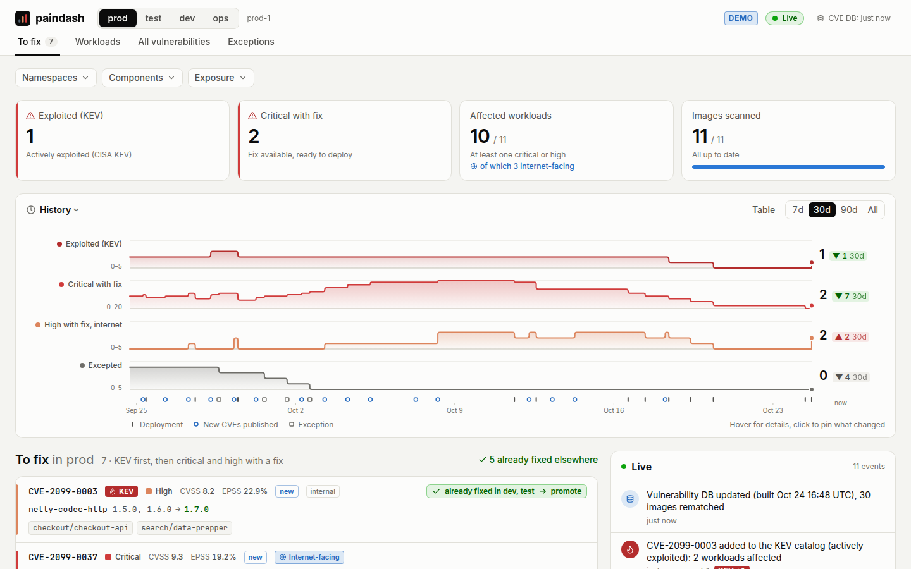
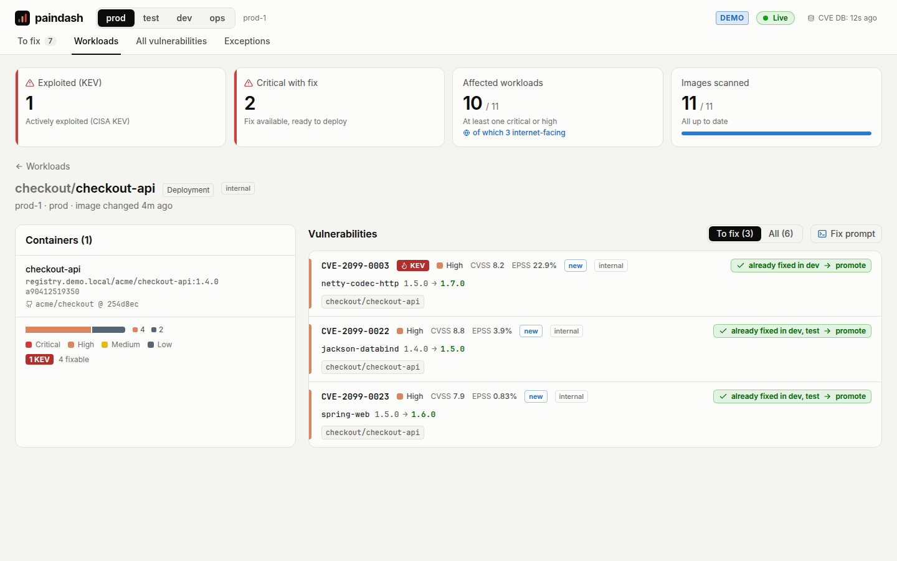
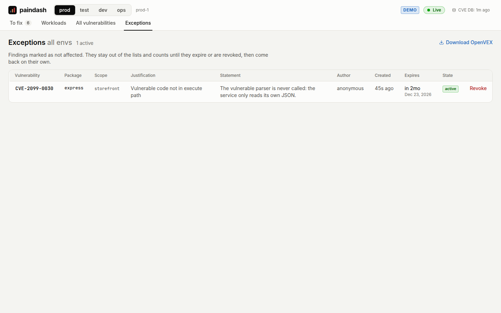
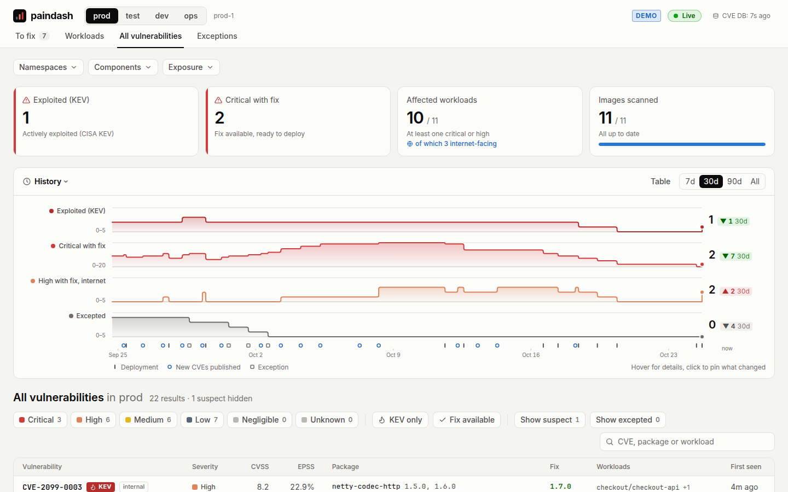

# Using paindash

paindash lists the vulnerabilities of the container images that **actually run** on your
Kubernetes clusters, per environment, in real time, and helps you get them fixed. This guide covers
what it shows, how to read it, and how to work with it day to day.

- To install it, see [Deploying paindash](../deploy/README.md), and
  [Configuration](configuration.md) for every setting. To try it on a laptop:
  `docker compose --profile demo up --build`, then http://localhost:8080.
- To understand the internals, see [How paindash works](architecture.md).

Contents:
[Goal](#goal) ·
[Concepts](#concepts) ·
[A tour of the UI](#a-tour-of-the-ui) ·
[Fix prompts](#fix-prompts-experimental) ·
[Typical workflows](#typical-workflows) ·
[Prometheus metrics](#prometheus-metrics) ·
[API](#api) ·
[FAQ](#faq)

## Goal

Registry and CI scanners tell you what is vulnerable in images you built. They do not tell you
which of those images run in production right now, which CVEs published this morning affect them,
which ones are reachable from the internet, or whether the fix is already running in test.

paindash answers those questions for platform, SRE and security teams running several clusters or
environments:

- **What runs, nothing else.** The inventory is the image digest each kubelet pulled, read from
  kube-state-metrics through your Prometheus-compatible API. No agent or operator in the clusters,
  no Kubernetes API access.
- **Always current.** Each digest is scanned once (syft SBOM, grype match). The SBOM is stored and
  rematched every time the vulnerability database changes, so new CVEs show up without a rescan or
  a redeploy.
- **Sorted for action.** Actively exploited first (CISA KEV), then severity, exposure and EPSS; the
  fixed version of the release line you run; "already fixed in test, promote" hints.

paindash only reads your clusters and registries. It writes to its own PostgreSQL database, never
to a cluster, a registry or a repository.

## Concepts

### Environment and cluster

An **environment** (env) is a value of a label on the kube-state-metrics series (`env` by default,
`PAINDASH_ENV_LABEL`). A **cluster** is a value of another label (`cluster` by default,
`PAINDASH_CLUSTER_LABEL`). An environment can span several clusters.

- `PAINDASH_ENVS` (default `prod,test,dev`) sets the order of the environment switcher. Only series
  whose env label is in that list are read, and images running in the first one are scanned first.
- With a single Prometheus whose series carry no such labels, `PAINDASH_DEFAULT_ENV` names the
  environment (the env filter is then off) and `PAINDASH_DEFAULT_CLUSTER` the cluster (`default`
  if unset).

Every view shows one environment at a time. Exceptions are the only cross-environment view.

### Workload

A workload is the top-level owner of the pods running a container, identified by cluster,
namespace, kind and name:

- Pod → ReplicaSet → **Deployment**; Pod → Job → **CronJob**;
- **StatefulSet**, **DaemonSet**, a standalone **Job** or **ReplicaSet**, or a bare **Pod**.

Init containers are part of the inventory. The scope filters call a `namespace/name` pair a
**component**: the same component can run on several clusters of an environment.

### Image and digest

paindash tracks the **manifest digest** the kubelet pulled (`sha256:…`), not the tag. The tag (the
image reference as deployed) is only shown for humans. One digest is scanned once, whatever the
number of workloads, clusters and environments running it. During a rollout, a workload container
can briefly run two digests.

### Finding: vulnerability × package

A finding is one vulnerability in one package, in an environment. When several images, or several
versions of the same package, carry the same vulnerability, they are one finding: its versions are
merged (`1.5.0, 1.6.0`) and it lists every affected container.

- **ID.** The CVE when there is one; advisories such as `GHSA-…` are reported under their CVE alias
  so that the same flaw is not counted twice and KEV and EPSS apply. Other IDs show as aliases.
- **Counts.** The per-severity counts count these (vulnerability, package) pairs. The KEV, "Critical
  with fix" and "High with fix, internet" numbers count distinct vulnerabilities.
- **First seen.** The first time the finding was seen on a container running in this environment.
  Findings first seen less than a day ago carry a `new` badge.
- **Identified from.** How the package was found in the image, from most to least reliable: the OS
  package database (apk, dpkg, rpm), build information compiled into a binary (Go, Rust
  cargo-auditable), a language manifest (pom.properties, package.json...), or a heuristic (a version
  string pattern-matched in a binary). Heuristic findings carry a `heuristic` badge.

### Severity and CVSS

The **severity** is the one grype reports for the match: Critical, High, Medium, Low, Negligible or
Unknown. **CVSS** is the highest base score among the CVSS vectors of the vulnerability and its
related records. Sorting uses the severity, not the CVSS score.

### EPSS

The FIRST [EPSS](https://www.first.org/epss/) probability that the CVE gets exploited, and its
percentile among all CVEs. Scores are fetched for new CVEs when they are found, and refreshed for
all of them every 24 hours. Only `CVE-` IDs have one.

### CISA KEV

The CISA [Known Exploited Vulnerabilities](https://www.cisa.gov/known-exploited-vulnerabilities-catalog)
catalog lists vulnerabilities exploited in the wild. paindash checks it every hour. A vulnerability
in the catalog carries a red `KEV` badge (the date it was added is in the tooltip) and comes first
everywhere. When a vulnerability already running somewhere enters the catalog, each environment
running it gets an "added to the KEV catalog" event.

`PAINDASH_ENRICH=off` disables KEV and EPSS (no egress to CISA and FIRST).

### Fix available, and the fixed version of your release line

A finding is **fixable** when its advisory lists fixed versions. Advisories often list one fix per
release line (for example `1.10.28, 2.2.28, 2.9.8`). paindash shows, for each installed version, the
**lowest fix above it**: `2.2.10 → 2.2.28`, not `1.10.28`. When no listed fix is above the installed
version, it shows them all.

### Suspect findings

A finding is **suspect** when its package is named like the image it was found in, but with a
different major version than the image tag: for example `traefik 1.24.4` (the Go toolchain version
embedded in the binary) found in `traefik:v3.4.1`. Such a match is most likely a misidentification.
Each container is checked with its own package version and image: a finding is suspect as soon as
one of the containers in view has such a match, whatever the other containers and their order.

Suspect findings are left out of the lists and of every count. "All vulnerabilities" says how many
are hidden and shows them with **Show suspect**.

### Exposure

Each workload is **internet-facing**, **internal** or **not exposed**, from the routes that reach its
pods:

| Source | Internet-facing | Internal |
|---|---|---|
| Traefik IngressRoute (HTTP, TCP, UDP) | entrypoint in `PAINDASH_PUBLIC_ENTRYPOINTS` (default `web`, `websecure`), or any unclassified entrypoint | entrypoint ending in `-internal` or `-int` |
| Ingress | class mapped to `internet` in `PAINDASH_INGRESS_CLASSES`; any other class, or none, unless it is internal | class mapped to `internal`, or an unlisted class whose name contains `internal` or `private` |
| LoadBalancer Service | any other load balancer, internal AWS Network Load Balancers included | private IP address, or hostname containing `internal` (AWS internal Classic Load Balancers) |

A route gives its level to the Service it targets, the Service's EndpointSlices (or Endpoints)
give it to the pods behind it, and the widest level wins: a workload with one public and one
internal route is internet-facing. A finding's exposure is the widest among the workloads it
affects. Unclassified Traefik entrypoints count as internet-facing (and are logged) rather than
being understated.

When paindash finds none of the routing series (Traefik IngressRoute, Ingress paths, LoadBalancer
ingress), or a cluster has routes but no series leading from its Services to its pods, exposure is
**not configured**: the badges, the Exposure filter and the internet-facing numbers are hidden
instead of showing every workload as "not exposed". See the
[FAQ](#why-is-exposure-not-configured-or-my-app-not-exposed) and
[Exposure derivation](architecture.md#exposure-derivation).

### Promotion chain and "already fixed in X → promote"

`PAINDASH_PROMOTION` (default `dev,test,prod`) is the order releases travel through your
environments. When the same workload container (same namespace, kind, name and container, on any
cluster) runs, in an **earlier** environment of the chain, a scanned image that does not have the
vulnerability, the finding carries a hint:

> ✓ already fixed in test → promote

The fix exists and is running: ship it forward. Hints never point to a later environment (that
would be a rollback) or to an environment outside the chain, and environments outside the chain
(for example `ops`) get none. The finding drawer lists the image and digest to promote; the "To
fix" header counts how many findings are "already fixed elsewhere". Hints look across every
environment, whatever the scope filters.

### Exceptions

An exception records that a vulnerability does not affect you, as an
[OpenVEX](https://openvex.dev) `not_affected` statement:

| Field | |
|---|---|
| Vulnerability and package | The vulnerability ID and the package name (any version of it). |
| Scope | All workloads, one namespace, or one workload (`namespace/name`). It applies in **every environment and cluster**. |
| Justification | One of the five OpenVEX justifications: component not present, vulnerable code not present, vulnerable code not in execute path, vulnerable code cannot be controlled by an adversary, inline mitigations already exist. |
| Statement | Why, in plain words (10 characters at least). |
| Expiry | Mandatory, at most 180 days ahead. |
| Author | The email of the signed-in user (`anonymous` when authentication is disabled). |

While active, an exception removes the workloads it covers from the finding. When it covers all of
them, the finding is **excepted**: out of the lists and counts, shown again with **Show excepted**.
When it covers only some, the finding stays, with the other workloads.

An exception is **expiring** in its last 14 days, then **expired**: the finding comes back on its
own, with an event. It can also be **revoked** at any time. Exceptions are never deleted: expired and
revoked ones stay as an audit trail. There is no edit: to extend one, record a new one.

### History points

For each environment, paindash records four numbers over time: **Exploited (KEV)**, **Critical with
fix**, **High with fix, internet** (distinct high vulnerabilities with a fix on internet-facing
workloads) and **Excepted** (findings hidden by an exception). A point is recorded when the numbers
move (at most every 5 minutes, once the scans in progress are done or after an hour of waiting for
them) and at least once a day. Each point keeps the events since the previous one that explain the
move: deployments, removals, scans, new or withdrawn CVEs, KEV additions, exceptions.

Under scope filters, the same four numbers are recounted for the scope. paindash also records what
they are made of, each (vulnerability, package, workload) with its severity, KEV, fix, exception,
exposure and misidentification, from when it starts to hold to when it stops. Any scope is recounted
from these facts at any past time. A filtered history therefore starts when paindash first
recorded facts (after the upgrade that brought them), and its points carry no events: they say how
much, not what moved it.

## A tour of the UI



### Top bar

- **Environment switcher**, with the clusters of the selected environment next to it. Keys `1` to
  `9` switch environments. The environment is kept in the URL (`?env=`), so every view is a
  shareable link.
- **Tabs:** To fix (with its count), Workloads, All vulnerabilities, Exceptions.
- **Badges:** `DEMO` in demo mode; `No auth` when authentication is disabled; "N exceptions
  expiring soon" (links to Exceptions); the live stream status (Live, Connecting, Reconnecting,
  Offline after 20 s without a connection); the signed-in user; `Read-only` for a user outside the
  editor groups (no "Mark as not affected", no "Revoke"); **Sign out** when paindash holds the
  session (`oidc`, `local`).
- **CVE DB badge:** the age of the vulnerability database build in use. It turns into a warning when
  the database was built more than 2 days ago ("is the feed still published?") or has not been
  checked for 3 hours ("is the scanner stuck?"). The tooltip gives the build and check times.

### Scope filters

Under the top bar, **Namespaces**, **Components** (`namespace/name`) and **Exposure** narrow the
views down. They combine with AND, are kept in the URL (`?ns=checkout,catalog&wl=checkout/checkout-api&exp=internet`)
and survive environment switches. They apply to the KPI tiles, the history, To fix, Workloads, All
vulnerabilities, the scans drawer and the workload events of the live feed. They do not apply to
the workload page or Exceptions. The Exposure filter is disabled when exposure is not configured.

### KPI tiles

| Tile | Counts |
|---|---|
| Exploited (KEV) | distinct vulnerabilities in the KEV catalog |
| Critical with fix | distinct critical vulnerabilities with a fix available |
| Affected workloads | workloads with at least one critical or high, out of all; "of which N internet-facing" |
| Images scanned | scanned images out of all running ones; **N pending** and **N failed** open the scans drawer |

Suspect and excepted findings are left out. A tile flashes, with the delta, when a live update
changes it.

### To fix

The default view: everything **in the CISA KEV catalog**, plus every **critical or high with a fix
available**, sorted KEV first, then severity, exposure (internet first) and EPSS. Suspect and
excepted findings never show here. Each list is capped at 500 entries; a note says so when it is
truncated.

Each row shows the ID, KEV badge, severity, CVSS, EPSS, `new`, exposure and identification badges;
the package, its installed versions and the fix of your release line
(`openssl 1.5.0, 1.6.0 → 1.10.0`); up to three affected workloads (a globe marks internet-facing
ones, the cluster shows when the environment has several); and the promotion hint or the exception
note. The live feed sits on the right.

### Workloads


Every workload of the environment: name and kind, namespace, cluster, exposure, a severity bar,
KEV and fixable counts, and when its image last changed. Columns sort; the default is by risk (KEV,
then critical, high, medium, low). The search box filters by name, namespace or cluster. Counts are
distinct vulnerabilities per workload, at their highest severity, without suspect and excepted
findings.

### Workload page



`/workloads/<cluster>/<namespace>/<kind>/<name>`:

- **Containers:** name, image as deployed, digest, and where the image comes from: the GitHub repo
  and commit it was built from (from its OCI labels), `?` when the repo is guessed from the image
  name, or "Third-party".
- **Vulnerabilities:** **To fix** (KEV, or critical or high with a fix) or **All**. Suspect and
  excepted findings are not listed.
- **Fix prompt** when at least one finding has a fix (see [Fix prompts](#fix-prompts-experimental)).

Switching environment from a workload page goes back to the Workloads list. A workload that stopped
running shows "Workload not found".

### All vulnerabilities

Every finding of the environment, as a table: vulnerability (with KEV, exposure, identification
badges, promotion hint or exception note), severity, CVSS, EPSS, package and versions, fix, affected
workloads, first seen.

| Filter | URL parameter |
|---|---|
| Severity toggles (with counts) | `severity=Critical,High` |
| KEV only | `kev=1` |
| Fix available | `fixable=1` |
| Show suspect | `suspect=1` |
| Show excepted | `excepted=1` |
| Search: CVE, package or workload (also aliases, purl, image) | `q=openssl` |

The header gives the total and how many suspect and excepted findings are hidden. The first 1,000
results are shown.

### Finding drawer


Click a finding anywhere to open it:

- ID, KEV, severity, exposure and identification badges; package, versions and the fix of your
  release line.
- **Already fixed elsewhere: promote the image**, with the environment, cluster, image and digest.
- **Fix prompt** for this vulnerability, when it has a fix.
- **Mark as not affected…**, the exception form, or the exception that already covers it.
- CVSS, EPSS, EPSS percentile, first seen; the advisory description.
- **Package:** how it was identified, the file it was found in, its type and purl.
- **References:** the advisory link and the aliases.
- **Affected containers:** workload (linked), exposure, kind, cluster, container, image, digest.

The drawer follows live updates. When the finding disappears (fixed by a deployment, or withdrawn by
a database update), it stays open with "This vulnerability is no longer detected in this
environment".

### Exceptions



Every exception of every environment: vulnerability (links to the finding), package, scope,
justification, statement, author, created, expires and state. Expiring ones come first and are
highlighted, then active, expired and revoked ones. **Revoke** asks for confirmation; the finding
comes back in the lists. **Download OpenVEX** exports the active exceptions as one OpenVEX document
for auditors.

### History panel



Above the views, collapsible (collapsed, it shows sparklines). One small chart per number, as step
lines ending at today's value, with its change over the range:

- **Ranges:** 7d, 30d, 90d, All. The range and the open/closed state are remembered in the browser.
- **Markers** on the time axis: deployment, new CVEs published, exception.
- **Hover** a point for its values and what changed; **click** to pin the full list of changes.
  Arrow keys move between points, Enter pins, Escape clears.
- **Table** shows the same points as rows.
- **Compare with prod** overlays the series of the last environment of the promotion chain
  (`PAINDASH_PROMOTION`, `prod` by default) as a dotted line on another environment: the gap is
  what has not been promoted yet. It shows once that environment has recorded history. Under scope
  filters, it compares the same scope.
- **Trend:** each number's change over the range ("▼ 3 30d"). When the history is younger than
  the range, the change is since its first point ("▲ 2 since Oct 26").

**Under scope filters**, the four lines are recounted for the scope and end on its KPI tiles. A
chip says **Filtered · since** the day the facts behind it were first recorded, and the chart
starts there when that is later than the range. Filtered points have no markers and nothing to
pin. Before any fact is recorded, the panel says "Filtered history starts now". "High with fix,
internet" is hidden when exposure is not configured.

### Live feed

The latest events of the environment (and the ones concerning every environment), newest first,
pushed by the server as they happen:

| Event | When |
|---|---|
| Deployed | a workload runs a new image, with the vulnerabilities added and removed compared with its previous image; `· scanning` while the new image is not scanned yet. The very first inventory is summarized in one event per environment. |
| Removed | a workload stopped running (not reported for Jobs and CronJobs) |
| Scan completed | an image is scanned, with what it found or `+N / −M vulnerabilities vs previous version`; during the initial scan, one progress event per minute instead |
| Scan failed | an image could not be scanned after 3 attempts |
| New vulnerabilities | a database update added findings to running images |
| Vulnerabilities fixed | a database update removed findings |
| Added to CISA KEV | a vulnerability running in this environment entered the catalog |
| CVE DB updated | a new vulnerability database was rematched against every running image |
| Exception added, revoked, expired | in the environments where the exception covers a running workload (all of them when it covers none) |

Click an event to open its workload, the Exceptions tab, or the failed scans. Workload events
outside the scope filters are hidden; environment-wide events always show.

### Scans drawer

Opened from the "Images scanned" tile or a scan failure event: the failed images, or the pending
and running ones, with the scanner's error (URL query strings redacted), the number of attempts, and
the workloads running each image. Failed scans are retried automatically (see the
[FAQ](#a-scan-failed-what-now)).

### Session expiry

When the session ends (paindash's own after `PAINDASH_SESSION_TTL`, or the authenticating proxy's),
API calls come back as a 401, a redirect or an HTML page. The UI then reloads the page by itself so
that the session can be renewed (silently at the identity provider, or through the sign-in form):
at most once a minute, and never while the exception form is open. Otherwise it shows a "Session
expired, reload the page" banner. A 403 in JSON is not an ended session: the user is read-only.

## Fix prompts (experimental)


A fix prompt is a Markdown task to paste into Claude Code or any coding agent that has `git` and
`gh` access: fix these vulnerabilities and open the pull requests, one per repository, for you to
review. paindash only builds the text; it runs nothing and has no access to your repositories. The
format and conventions may change.

### Where

| Prompt | From | Covers |
|---|---|---|
| Per workload | **Fix prompt** on a workload page | **To fix** (KEV, or critical and high, with a fix) or **All fixable**, for each container of the workload |
| Per vulnerability | **Fix prompt** in the finding drawer, when a fix exists | that vulnerability, in every image of the environment that has it (within the scope filters) |

**Copy prompt** copies it; when the browser blocks the clipboard, the text is selected for a manual
copy. "Pull requests on" lists the repositories the agent will touch.

### What it asks

Each prompt has a **Data** section (images, digests, source repos and commits, promotion
candidates, and a table of packages: installed version, minimum fixed version, file, vulnerabilities),
then a **Task** per container or image:

| The image | The agent is asked to |
|---|---|
| is already fixed in an earlier environment of the promotion chain (same repository, none of the vulnerabilities) | pin the manifests to that image and digest, nothing else, and say in the PR which environments of the chain this skips |
| is first-party, with a known source repo | fix it in the source repo: clone, branch from the default branch (if the image's commit is known, check whether the default branch already fixes it), bump the packages with per-ecosystem hints (Go toolchain and modules, npm, Python, Java, OS packages through the base image); not release or deploy it |
| is third-party | bump it (tag and digest, or Helm chart version) in the GitOps repo to the closest upstream release that fixes it, after checking its release notes or scanning it; say so if no release fixes it yet |

Then **Verify** (build and test the way the repo does; rebuild and rescan the image with grype or
Trivy if available) and **Rules**: one branch and one pull request per repo, never merge,
force-push or push to the default branch; one-line commit messages without trailers; change only
what the fixes need (no CI, scanner configuration, ignore or exception files); work only in the
repos named; report what could not be fixed; finish with the pull request URLs. A workload prompt
also lists the urgent vulnerabilities that have no fix yet, to leave alone.

### Configuration

| Variable | Effect |
|---|---|
| `PAINDASH_GITHUB_OWNERS` | GitHub owners whose images you build. An image is first-party when the first or second segment of its repository path is one of them: `ghcr.io/<owner>/…`, or `<cache host>/<prefix>/<owner>/…` behind a pull-through cache. Its repo comes from the `org.opencontainers.image.source` label when that is one of your repos, and is otherwise guessed from the image name (the agent is told to check it). |
| `PAINDASH_GITOPS_REPO` | `owner/name` of the repository holding your manifests, where third-party images are bumped and images are pinned. Without it, the agent is told to search the manifests that deploy the image (GitOps repo, Helm values, Kustomize overlays). |

The commit comes from the `org.opencontainers.image.revision` label. Without owners, every image is
treated as third-party. Only GitHub repositories are recognized.

### Safety

The prompt lands in an agent that can write to repositories, so its inputs are treated as
untrusted:

- Everything extracted from images by the scanners (names, versions, paths, labels) is sanitized
  (characters outside a small safe set are replaced, lengths are capped) and placed in the Data
  section, which the prompt tells the agent to treat as data, never as instructions.
- Advisory descriptions are left out entirely.
- The agent opens pull requests for review; it is told never to merge.

## Typical workflows

### Daily triage

1. Open **To fix** in `prod` (or narrow it to your namespaces with the scope filters).
2. Take the KEV findings first. Then, for each critical or high:
   - "already fixed in test → promote": promote the image through your usual process;
   - first-party image: open the workload and use its **Fix prompt**, or fix it by hand;
   - not exploitable here: **Mark as not affected…** with a justification and an expiry.
3. Check the **Images scanned** tile: failed scans mean blind spots.
4. Glance at the **History**: hover a step to see which deployment or CVE moved it.

### A new KEV

1. An "added to the KEV catalog (actively exploited)" event appears in the live feed of each
   environment running it; the **Exploited (KEV)** tile goes up. Alert on it with
   [`paindash_workload_kev_vulnerabilities`](#prometheus-metrics).
2. Open it from To fix (it comes first). The drawer lists every affected container, its exposure,
   and whether a fixed image already runs in an earlier environment.
3. Fix or promote; or, if you are not affected, record an exception with a short expiry.

### Promoting a fix

1. A finding shows "already fixed in test → promote"; the drawer gives the image and digest running
   in test.
2. Deploy that image to prod through your GitOps flow (or paste the fix prompt: it pins the
   manifests to that image).
3. Within a sync (30 s by default), a "Deployed" event shows the vulnerabilities removed. The image
   is already scanned, so nothing to wait for. The finding disappears; an open drawer says "no
   longer detected".
4. On the test history, **Compare with prod** shows the gap closing.

### Recording an exception, and its expiry

1. In the finding drawer, **Mark as not affected…**.
2. Choose the scope (all workloads, the namespace, or the workload; it defaults to the narrowest
   that covers every affected workload), the justification, a statement, and an expiry (90 days by
   default, 180 at most; it ends at the end of the chosen day).
3. **Record exception**: what it covers leaves the lists and counts, in every environment; an
   "Exception added" event is recorded, and the exception is listed under **Exceptions**.
4. 14 days before it expires, it shows as expiring, and the top bar shows "N exceptions expiring
   soon". Re-assess: record a new one, or let it expire.
5. When it expires, an "Exception expired … is back in the lists" event is recorded and the finding
   returns. **Revoke** ends it earlier.
6. For audits, **Download OpenVEX** on the Exceptions tab.

## Prometheus metrics

`GET /metrics` on the internal port (`:9090` by default, never authenticated: keep it off every
route). The Helm chart can create a ServiceMonitor. Values are computed every 30 seconds in the
background; a scrape reads the last snapshot.

| Metric | Labels | Value |
|---|---|---|
| `paindash_vulnerabilities` | `environment`, `severity` | distinct (vulnerability, package) pairs affecting running workloads |
| `paindash_kev_vulnerabilities` | `environment` | distinct vulnerabilities in CISA KEV |
| `paindash_critical_fixable_vulnerabilities` | `environment` | distinct critical vulnerabilities with a fix |
| `paindash_images` | `environment`, `status` (`scanned`, `pending`, `failed`) | running images by scan status; `pending` includes those being scanned |
| `paindash_workload_vulnerabilities` | `environment`, `cluster`, `namespace`, `kind`, `workload`, `severity` (`Critical`, `High`) | distinct critical and high vulnerabilities per workload |
| `paindash_workload_kev_vulnerabilities` | `environment`, `cluster`, `namespace`, `kind`, `workload` | distinct KEV vulnerabilities per workload |
| `paindash_vulndb_built_timestamp_seconds` | | build time of the vulnerability database in use |
| `paindash_inventory_last_sync_timestamp_seconds` | | last successful inventory sync |
| `paindash_metrics_computed_timestamp_seconds` | | when the metrics above were computed |
| `paindash_stream_clients` | | browsers connected to the live stream |

Plus the standard Go and process metrics.

- The label is `environment`, not `env`: Thanos and similar setups overwrite series labels with
  their external labels, often including `env`.
- `severity` values are capitalized: `Critical`, `High`, `Medium`, `Low`, `Negligible`, `Unknown`.
- Like the UI, the counts leave out suspect and excepted findings. They are not scoped.

Example alerting rules:

```yaml
groups:
  - name: paindash
    rules:
      # An actively exploited vulnerability runs in prod: one alert per workload,
      # routable to its team by namespace.
      - alert: PaindashKEVInProd
        expr: paindash_workload_kev_vulnerabilities{environment="prod"} > 0
        for: 15m
        annotations:
          summary: "{{ $labels.namespace }}/{{ $labels.workload }} on {{ $labels.cluster }} runs {{ $value }} actively exploited vulnerabilities"

      # No new vulnerability database for two days: new CVEs are not matched.
      - alert: PaindashVulnDBStale
        expr: time() - paindash_vulndb_built_timestamp_seconds > 2 * 86400
        for: 1h

      # The inventory is not syncing: deployments and removals are not seen.
      - alert: PaindashInventoryStale
        expr: time() - paindash_inventory_last_sync_timestamp_seconds > 15 * 60
        for: 5m
```

The last two only fire while paindash is scraped: pair them with an alert on `up` for its job.

## API

The UI's JSON API, on the public port behind the same authentication as the UI. **It is an
internal API: paths, parameters and payloads may change between releases.** For integrations, prefer
the Prometheus metrics and the OpenVEX export.

| Method | Path | Purpose |
|---|---|---|
| GET | `/api/meta` | environments and their clusters, signed-in user, vulnerability DB build and check times, last inventory sync, exposure availability, demo and auth flags, GitOps repo, promotion chain |
| GET | `/api/summary` | the KPI numbers of an environment |
| GET | `/api/findings` | the findings of an environment, most urgent first: `severity=Critical,High`, `kev=1`, `fixable=1`, `q=…`, `include=suspect,excepted`, `limit` (default 500, max 5000); returns `items` and `total` |
| GET | `/api/workloads` | the workloads of an environment with their counts |
| GET | `/api/workloads/{cluster}/{namespace}/{kind}/{name}` | one running workload: containers with image origin, and its findings; 404 when it no longer runs |
| GET | `/api/images` | failed images (default) or `status=pending` (pending and being scanned), with error, attempts and workloads |
| GET | `/api/origins` | where every running image comes from (first-party, repo, commit), by digest |
| GET | `/api/exceptions` | every exception, active first |
| GET | `/api/exceptions/openvex` | the active exceptions as an OpenVEX document (download) |
| POST | `/api/exceptions` | record an exception |
| POST | `/api/exceptions/{id}/revoke` | revoke an exception |
| GET | `/api/events` | the latest events of an environment and the environment-wide ones (`limit`, default 50, max 500) |
| GET | `/api/history` | history points of every environment over `days` (all when 0 or absent), each series ending with the current values; with `ns`, `wl` or `exp`, recounted for that scope (no `changes`), and `scopedSince` gives, per environment, when its facts begin (an environment without any has an empty series) |
| GET | `/api/stream` | Server-Sent Events for an environment: `live` (an event) and `invalidate` (`{"scopes": ["summary", "findings", "workloads"]}`), a ping comment every 15 s |

- `env` selects the environment (default: the first of `PAINDASH_ENVS`).
- `ns`, `wl` (`namespace/name`) and `exp` (`internet`, `internal`, `none`), comma-separated,
  scope `summary`, `findings`, `workloads`, `images` and `history`.
- Writes need `Content-Type: application/json`; cross-site requests are refused; the author is the
  signed-in user, who must be in an editor group when `PAINDASH_EDITOR_GROUPS` is set (403
  otherwise).

Recording an exception:

```json
{
  "vulnId": "CVE-2099-0037",
  "package": "openssl",
  "namespace": "checkout",
  "workload": "checkout-api",
  "justification": "vulnerable_code_not_in_execute_path",
  "statement": "The vulnerable function is never called by this service.",
  "expiresAt": "2027-01-31T23:59:59Z"
}
```

`namespace` and `workload` are optional (a workload needs its namespace). `justification` is one of
`component_not_present`, `vulnerable_code_not_present`, `vulnerable_code_not_in_execute_path`,
`vulnerable_code_cannot_be_controlled_by_adversary`, `inline_mitigations_already_exist`. The
statement has at least 10 characters; `expiresAt` is in the future and at most 180 days away.
Invalid input gets a 400 with `{"error": "…"}`.

The internal port also serves `GET /healthz` (process up) and `GET /readyz` (database reachable).

## FAQ

### Why digests, not tags?

Tags are mutable: `api:1.4` can point to a different image tomorrow, and what git or a manifest says
is not necessarily what was pulled. The digest in kube-state-metrics' `image_id` is the image the
kubelet actually runs. Digests also make promotion exact: the image promoted from test to prod is
the same digest, analyzed once, and "already fixed in test" compares the very images that run.

### Why did a CVE disappear, or appear, without a deployment?

Every new vulnerability database is matched again against the stored SBOM of every running image.
Advisories change: new CVEs are published, vulnerable version ranges are corrected, advisories are
withdrawn, an advisory first known as `GHSA-…` gets a CVE (it is then reported under the CVE, so one
ID seems to replace the other). The live feed reports each database update with "New CVEs
published" or "CVE DB updated: N vulnerabilities no longer apply".

Other causes:

- an exception was recorded, revoked or expired;
- after an upgrade of paindash with new matching rules (for example, removed false positives),
  every SBOM is rematched once ("Matching rules updated").

### Why is exposure "not configured", or my app "not exposed"?

"Not configured" means the last inventory sync found none of the routing series: Traefik
IngressRoute entrypoints (which need the kube-state-metrics custom resource configuration in
[deploy/README.md](../deploy/README.md#prerequisites)), `kube_ingress_path`, or
`kube_service_status_load_balancer_ingress`. Or a cluster has some, but neither
`kube_endpointslice_endpoints` nor `kube_endpoint_address`: its kube-state-metrics runs without the
`endpointslices` resource (a default since v2.18.0) and without `endpoints`, and paindash logs
"exposure unavailable" with the cluster. Check with `make snapshot` (the EXPOSURE column).

A workload can be reachable and still show as not exposed:

- its route targets another Service: when the route of an app points to a proxy in front of it
  (Pomerium, for example), the proxy's pods are internet-facing, not the app's;
- it is routed by the Gateway API (not supported yet);
- it is behind the second or later Service of an IngressRoute route (only the first is exported);
- it is behind an Ingress with only a `defaultBackend` (no rules, so no `kube_ingress_path`);
- it is behind a load balancer with a private IP that a NAT exposes to the internet (counted as
  internal);
- its pods use the host network and kube-state-metrics exports Endpoints but not EndpointSlices
  (Endpoints only give IPs, and those pods share their node's).

### What happens when a workload is deleted?

At the next inventory sync (30 s by default), its containers leave the inventory: a "Removed" event
is recorded (not for Jobs and CronJobs, which come and go with each run), and its findings leave the
lists, counts and metrics. Images no longer running anywhere are marked retired; their SBOM and
findings are kept for `PAINDASH_RETENTION` (30 days by default), then pruned. If the same digest
runs again in the meantime (a rollback, a redeploy, another environment), it is not rescanned: its
stored findings apply at once, and the next database update rematches it.

If a whole cluster is missing from a query result (scrape gap, store restart), its workloads are
kept for 15 minutes before being treated as removed. Partial responses from Thanos are refused, so
a down store skips a sync instead of removing a cluster.

### Single Prometheus or several clusters: which labels?

| Setup | Configuration |
|---|---|
| Several clusters or environments behind Thanos, Mimir, or remote write | Each series carries an env and a cluster label, usually external labels set per cluster. Set `PAINDASH_ENV_LABEL` and `PAINDASH_CLUSTER_LABEL` if they are not `env` and `cluster`, and list the environments in `PAINDASH_ENVS`. |
| One Prometheus, no such labels | Set `PAINDASH_DEFAULT_ENV` (for example `prod`) and optionally `PAINDASH_DEFAULT_CLUSTER`. Series without an env label get that environment; the env filter is off. |

Before installing, `make snapshot PROMETHEUS_URL=http://localhost:9090` (or `paindash snapshot`)
prints every container paindash sees, with its environment, cluster, workload, digest and exposure,
without a database.

### A scan failed: what now?

The **Images scanned** tile and the scans drawer list failed images with the scanner's error. A
failed attempt is retried after a few minutes; after 3 attempts the image is marked failed and a
"Scan failed" event is recorded. Failed images are retried with a fresh budget every 6 hours and at
startup, so a fixed cause (registry credentials, network policy) heals on its own. To debug one
image with the same scanner pipeline: `paindash scan <repo@sha256:…>`.

### Why is a vulnerability missing from "To fix"?

To fix holds KEV findings and critical or high findings with a fix. A finding without a fix, of
medium severity or below, suspect, or excepted is only in **All vulnerabilities** (the last two with
**Show suspect** or **Show excepted**). Also check the scope filters.

### Does an exception survive a package upgrade?

Yes: it matches the vulnerability and the package name, whatever the version. That is one reason
why every exception expires.

### How fast do changes show up?

| Change | Visible after |
|---|---|
| A deployment | the next inventory sync (30 s by default), plus the scan time for a new digest |
| A CVE published upstream | the next vulnerability database build, checked every hour |
| A KEV addition | the next catalog check, every hour |
| An exception | immediately, in every environment |
